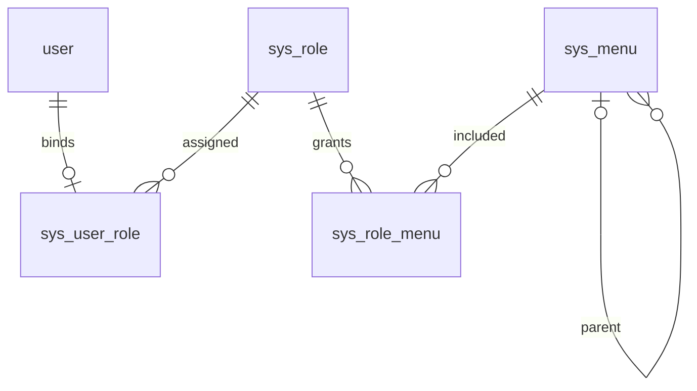

# RBAC 权限管理

## 启动与初始化

保持现有 MySQL 连接配置，运行 `mvn spring-boot:run`。启动时由 Flyway 执行 `db/migration/V3__rbac_schema.sql`，创建角色、菜单、角色菜单、用户角色表及初始化版本表；不会删除已有用户或修改密码。已有用户默认绑定普通用户角色，新注册用户也只能获得普通用户角色。

初始化管理员需明确指定一个**已有且唯一的登录账号**：

```powershell
$env:RBAC_BOOTSTRAP_ADMIN_ACCOUNT = '实际管理员账号'
mvn spring-boot:run
```

也可以在已被 Git 忽略的 `application-local.yaml` 中添加：

```yaml
rbac:
  bootstrap-admin-account: 实际管理员账号
```

仅当系统没有超级管理员时进行初始化；已有超级管理员时不自动重新分配。不会创建默认密码，也不会把首个公开注册者提升为管理员。未配置时，普通用户仍能使用群聊和消息演示；管理功能等待管理员初始化。

表结构统一由 Flyway 管理，SQL 已幂等；菜单和内置角色采用幂等插入，普通角色初始授权只执行一次，重启不会恢复已撤销的授权。

## 模型



- `sys_user_role.user_id` 是主键，从数据库层面限制一人最多一个角色。创建用户时会在同一事务中绑定角色；替换角色也是单一事务，没有多角色叠加。
- `sys_role.code` 唯一。内置 `super_admin` 与 `member`；普通用户初始拥有群聊和消息演示权限。
- `sys_menu` 包含 `DIRECTORY` 目录、`MENU` 页面、`BUTTON` 按钮；页面和按钮的权限标识唯一。目录下放目录或页面，页面下放按钮。
- `sys_role_menu` 使用 `(role_id, menu_id)` 联合主键。勾选按钮时自动补齐所属页面和上级目录。
- 兼容既有 `user` 表，未增加对它的外键。用户删除接口同步删除角色绑定；直接 SQL 删除用户时也需清理绑定。

## 页面

| 地址 | 功能 |
| --- | --- |
| `/users.html` | 姓名/账号搜索、分页、新增编辑、改密、删除、角色单选绑定 |
| `/roles.html` | 角色搜索、增删改、启停、用户数量、权限树分配 |
| `/menus.html` | 目录/页面/按钮树、搜索、折叠、排序、增删改 |

前端导航读取 `/api/auth/access`；按钮按权限显示，直接输入未授权页面地址会显示无权限状态。后端独立检查权限，隐藏按钮不能代替后端鉴权。自定义菜单只定义导航和权限标识，不自动生成对应业务页面或接口。

## 接口

请求头延用 `satoken: <tokenValue>`。未登录返回 401，无权限返回 403，字段错误返回 400，资源不存在返回 404，重复或有关联数据返回 409。错误体为 `{ "status": 403, "message": "没有操作权限" }`。

| 方法与路径 | 权限 / 说明 |
| --- | --- |
| `GET /api/auth/access` | 登录即可；返回角色、权限集合、可见菜单 |
| `GET /api/users?page=1&keyword=张` | `user:read`，每页 20 条 |
| `GET /api/users/{id}` | `user:read` |
| `POST /api/users` | `user:create`；可选单个 `roleId`，指定时额外检查 `user:assign-role` |
| `PUT /api/users/{id}` | `user:update`；省略 `roleId` 保留原角色，指定时额外检查 `user:assign-role` |
| `DELETE /api/users/{id}` | `user:delete` |
| `PUT /api/users/{id}/role` | `user:assign-role`，请求 `{ "roleId": 2 }` |
| `GET /api/roles/options` | `user:assign-role`，启用角色供单选 |
| `GET /api/roles` | `role:read` |
| `POST /api/roles` | `role:create` |
| `PUT /api/roles/{id}` | `role:update` |
| `DELETE /api/roles/{id}` | `role:delete`，绑定了用户的角色不能删除 |
| `GET /api/roles/{id}/permissions` | `role:grant`，返回选中的菜单 ID 数组 |
| `PUT /api/roles/{id}/permissions` | `role:grant`，请求 `{ "menuIds": [10, 11] }`；空数组清空 |
| `GET /api/menus/permission-tree` | `role:grant`，返回含目录/页面/按钮的平铺节点，使用 `parentId` 组树 |
| `GET /api/menus` | `menu:read` |
| `POST /api/menus` | `menu:create` |
| `PUT /api/menus/{id}` | `menu:update` |
| `DELETE /api/menus/{id}` | `menu:delete`；有子菜单时拒绝，删除时清理关联授权 |

角色请求：`{"name":"用户管理员","code":"user_manager","description":"维护用户资料","enabled":true}`。

菜单请求：`{"parentId":1,"name":"业务页面","type":"MENU","path":"/example.html","permission":"example:read","sortOrder":40,"enabled":true}`。

用户响应在原 `id/name/account` 基础上增加 `roleId/roleName`，不返回密码。公开注册接口拒绝指定 `roleId`。

## 权限边界

- Sa-Token 的 `StpInterface` 从数据库实时读取权限，HTTP 请求及 WebSocket 鉴权、收发时校验，角色替换、停用和撤销权限对现有 Token 生效。
- 群聊 HTTP 与 WebSocket 均检查 `chat:access`，同时保留原有群成员边界；消息演示检查 `message:access`。
- 超级管理员拥有全部权限。只有超级管理员能维护超级管理员账号、授予超级管理员角色。其他管理者不能授予或管理超出自身权限范围的角色。
- 角色绑定、用户删除及权限配置使用数据库行锁协调，避免并发移除最后一个超级管理员。
- 内置角色不能删除、修改编码或停用；超级管理员权限不可清空。内置菜单只允许调整名称和排序，以保留恢复管理的入口。
- 停用角色后保留登录/退出能力，但业务接口返回 403；停用菜单或其祖先会撤销该分支的有效权限。
- 自定义权限必须在对应后端业务接口中调用权限检查。仅创建菜单不会自动保护新接口。

## 验证

`mvn '-DforkCount=0' test`：包含独立 H2 数据库的 RBAC 集成测试，验证越权、单角色绑定、权限即时撤销、角色停用、初始化资源保护、菜单校验、事务回滚、并发管理员保护，以及既有群聊回归测试。

真实 MySQL 用户集成测试仍需显式设置 `RUN_MYSQL_INTEGRATION_TESTS=true`，会创建并清理临时账号；测试夹具显式设置管理员角色，公开注册接口不提供提权能力。
